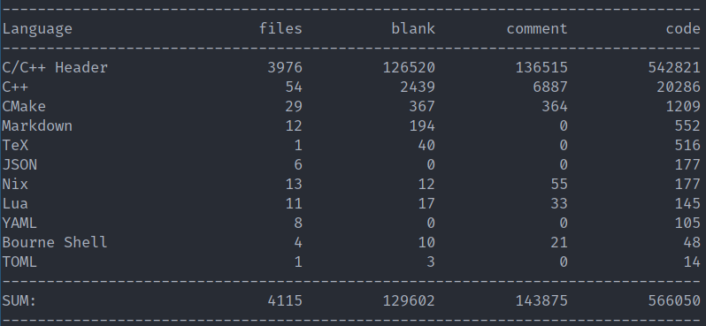

# d-SEAMS

**Deferred Structural Elucidation Analysis for Molecular Simulations.**
d-SEAMS reads a molecular-dynamics trajectory and names the ice in it:
CHILL+, topological cages, primitive rings, and Steinhardt q_l, on one
shared neighbour list.

This repository is the C++ engine (`libyodaLib`), the C API `libseams`
(`include/seams.h`), the C ABI `libseams_lang` (`bindings/cxx/seams_lang.h`),
the `seams` command, and the LAMMPS, GROMACS, OpenMM, PLUMED, and in-situ
drivers. Python, Lua, Fennel, R, Julia, Rust, and Fortran are separate
repositories, released at this version.

[](https://github.com/d-SEAMS/seams-core/actions/workflows/ci_test.yml)
[](https://anaconda.org/conda-forge/libseams)
[](https://pypi.org/project/pydseamslib/)
[](https://docs.dseams.info)
[](https://doi.org/10.1021/acs.jcim.0c00031)

Manual: [docs.dseams.info](https://docs.dseams.info).
Project site: [dseams.info](https://dseams.info).
Datasets: [figshare](https://figshare.com/projects/d-SEAMS_Datasets/73545).
Zenodo: [d-seams](https://zenodo.org/communities/d-seams/).
Wiki: [wiki.dseams.info](https://wiki.dseams.info).

```bash
seams read water.lammpstrj
seams chill-plus water.lammpstrj --cutoff 3.5
seams cages water.lammpstrj
```

C and C++ are documented here, as are the GROMACS, LAMMPS, OpenMM, PLUMED
and in-situ engine drivers. Each other language binding is its own
repository.

The d-SEAMS PLUMED plugin v0.4.1 has a
[PLUMED-NEST egg](https://www.plumed-nest.org/eggs/26/018/)
(plumID:26.018) and a
[companion repository](https://github.com/d-SEAMS/dseams-plumed). It is
tested with PLUMED v2.10 and master.

| Language | Repository | Package |
|----------|------------|---------|
| Python | [d-SEAMS/PydSEAMSlib](https://github.com/d-SEAMS/PydSEAMSlib) | `pydseamslib` on PyPI (`import dseams`, `import pydseams`) |
| Lua, Fennel | [d-SEAMS/yodaStruct](https://github.com/d-SEAMS/yodaStruct) | Git source (`require("dseams")`) |
| R | [d-SEAMS/dseams-r](https://github.com/d-SEAMS/dseams-r) | `dseams` |
| Julia | [d-SEAMS/Dseams.jl](https://github.com/d-SEAMS/Dseams.jl) | `Dseams` |
| Rust | [d-SEAMS/dseams-rs](https://github.com/d-SEAMS/dseams-rs) | crates `dseams-sys`, `dseams` |
| Fortran | [d-SEAMS/dseams-fortran](https://github.com/d-SEAMS/dseams-fortran) | fpm Git dependency `dseams` |

Periodic k-nearest neighbour search is
[linkcell](https://github.com/d-SEAMS/linkcell).

Build with `pixi run setup && pixi run build && pixi run test`, or with
the Nix flake: `nix build` and `nix develop`.

Released versions live in [CHANGELOG.md](CHANGELOG.md) (Keep a Changelog).

# Runtime configuration

Knobs that change between machines and jobs are twelve-factor: they
are not compiled in. Defaults live in the binary. An optional dotenv
file (`SEAMS_CONFIG` or `./seams.env`) fills unset variables. The
process environment wins over the file. CLI flags win over the
environment. `seams --print-config` prints the resolved table.

| Variable | Meaning | Default |
| --- | --- | --- |
| `SEAMS_FRAME` / `SEAMS_LAST` | Frame range (1-based) | `1` / unset |
| `SEAMS_JOBS` | OpenMP frame workers | `1` |
| `SEAMS_TYPE` | Atom type (`0` guesses) | `0` |
| `SEAMS_CUTOFF` | Neighbour cutoff (Å) | `3.5` |
| `SEAMS_CAGE_EDGE` | Face-edge window for a cage signature, in the file's coordinate units. `none` leaves the bound to the face census | `2.65,3.15` |
| `SEAMS_K` | *k* for k-NN / seeded cages | `4` |
| `SEAMS_GRAPH` | `cutoff` / `knn` / `knn-union` / `seeded` | `seeded` |
| `SEAMS_RESIDENT` | Fraction of free GPU memory for a TUM batch | `0.80` |
| `SEAMS_CELL` | Link-cell hint so NPT frames share a grid (Å) | `3.0` |
| `SEAMS_OFFLOAD` | OpenMP target Steinhardt and TUM cages (`0` disables) | on if devices exist |
| `LINKCELL_TPP` | Threads per particle on the device k-NN | occupancy picker |
| `LINKCELL_BLOCK` | CUDA block size | occupancy picker |
| `YODA_FENNEL_PATH` / `YODA_LUA_PATH` | Installed Lua/Fennel search roots | build paths |

`OMP_NUM_THREADS` and `CUDA_VISIBLE_DEVICES` keep their usual meaning.
A commented template is `seams.env.example`. Analysis choice (which
command, which Lua script, which Python call) is not this table.

\note The <a href="https://docs.dseams.info/howto/from-trajectory.html">trajectory how-to</a> describes the examples and how to obtain
the data-sets (trajectories) <a
href="https://figshare.com/projects/d-SEAMS_Datasets/73545">from figshare</a>.

\warning The live builds are `pixi` + meson, or the Nix flake. The
CMake-era `yodaStruct` derivation is gone. Manage compiler and library
versions yourself if you do not use `pixi`, `nix`, or the `conda`
environment.

# Citation

- This has been published at the [Journal of Chemical Information and Modeling
  (JCIM)](https://doi.org/10.1021/acs.jcim.0c00031)

- You may also read [the preprint on arXiv](https://arxiv.org/abs/1909.09830)

If you use this software please cite the following:

    Goswami, R., Goswami, A., & Singh, J. K. (2020). d-SEAMS: Deferred Structural Elucidation Analysis for Molecular Simulations. Journal of Chemical Information and Modeling. https://doi.org/10.1021/acs.jcim.0c00031

The corresponding `bibtex` entry is:

    @Article{Goswami2020,
    author={Goswami, Rohit and Goswami, Amrita and Singh, Jayant K.},
    title={d-SEAMS: Deferred Structural Elucidation Analysis for Molecular Simulations},
    journal={Journal of Chemical Information and Modeling},
    year={2020},
    month={Mar},
    day={20},
    publisher={American Chemical Society},
    issn={1549-9596},
    doi={10.1021/acs.jcim.0c00031},
    url={https://doi.org/10.1021/acs.jcim.0c00031}
    }

# Compilation

The live builds are `pixi` + meson, or the Nix flake. This repository
builds `libyodaLib`, `libseams`, `libseams_lang`, and the `seams` CLI.
The language packages
(`pydseamslib`, the crates, the fpm package, the R and
Julia packages) are built and released by their own repositories, listed
above. `docs/orgmode/getting-started/install.org` has every install line.

```bash
pixi run setup && pixi run build && pixi run test
./bbdir/seams read input/traj/exampleTraj.lammpstrj
```

`environment.yml` is a micromamba fallback (meson, Eigen, BLAS,
Catch2). It does not install Lua or yaml-cpp.

### Nix

The flake builds `libyodaLib` and the `seams` CLI with meson. Optional
backends that meson would otherwise wrap-git (vesin, readcon-core,
linkcell) or
that nixpkgs does not ship (chemfiles) stay off unless a package is
already in the closure.

```bash
nix build                  # ./result/bin/seams
nix run . -- read input/traj/exampleTraj.lammpstrj
nix develop                # compiler, Eigen, BLAS, Catch2, gdb
nix flake update           # refresh the nixpkgs pin
nix fmt
```

`nix build` runs the Catch2 suite. The Lua library is
[yodaStruct](https://github.com/d-SEAMS/yodaStruct); Python is
[PydSEAMSlib](https://github.com/d-SEAMS/PydSEAMSlib). Those
repositories have matching flakes.

The [dseams Cachix](https://dseams.cachix.org/) cache is optional:

```bash
nix-env -iA cachix -f https://cachix.org/api/v1/install
cachix use dseams
```

### Usage

```bash
seams read input/traj/exampleTraj.lammpstrj
seams chill-plus input/traj/exampleTraj.lammpstrj --cutoff 3.5
seams cages input/traj/exampleTraj.lammpstrj
seams cages input/traj/exampleTraj.lammpstrj --signature sodalite --graph cutoff
seams cages input/traj/genice_sI.lammpstrj --graph cutoff --signature 512 --guest-types 2
seams fingerprint input/traj/genice_sI.lammpstrj --graph knn --hops 3 --emit-library sI > si.keys
seams fingerprint input/traj/genice_sII.lammpstrj --graph knn --hops 3 --library si.keys
seams ions brine.lammpstrj --ion-types 3,4 --complete
```

`fingerprint` keys every molecule's rooted bonded neighbourhood (nauty
certificate when linked, Weisfeiler-Leman hash otherwise), builds key
libraries from reference lattices and names molecules by them, several
libraries at different hop counts falling back to the deepest that knows
a molecule; `ions` classes ions by their first water shell against the
seeded cage assignment; `cages --signature` enumerates polyhedra by
ring-size census and, with `--guest-types`, places guests in them.

Lua scripts live in the [yodaStruct](https://github.com/d-SEAMS/yodaStruct)
checkout (`require("dseams")`). Paths in those examples are relative to
the directory you invoke them from.

### Language Server Support

```bash
nix develop
meson setup bbdir -Dwith_tests=true
ln -s bbdir/compile_commands.json .
```

**Do Not** commit `compile_commands.json`.

## Development

```bash
nix develop
meson setup bbdir -Dwith_tests=true
meson compile -C bbdir
meson test -C bbdir
```

# Running

```bash
nix build
./result/bin/seams --help
./result/bin/seams --frame 1 --last 100 --jobs 8 --type 1 --graph seeded cages dump.lammpstrj
./result/bin/seams --graph cutoff cages dump.lammpstrj
./result/bin/seams --graph knn cages dump.lammpstrj
./result/bin/seams --graph cutoff cages dump.lammpstrj --signature 4:6,6:8
```

To run the sample inputs, stay in the repository root so `input/` is a
child directory.

An OpenMM trajectory can call the same classifiers in process. The
reporter, the TIP4P/Ice field, and the 4096-molecule driver are
described in `docs/openmm.md`.

## Reproducing the paper

The benchmark campaign, the public-trajectory walks and the tool comparison
behind the d-SEAMS 2.0 paper live in
[dseams2_repro](https://github.com/d-SEAMS/dseams2_repro), which builds
this engine at a locked revision alongside its baseline and both front
ends.

## Tests

```bash
nix build          # meson test is the install check
nix develop --command meson test -C bbdir
```

# Developer Documentation

The flake pins nixpkgs. To move the pin:

```bash
nix flake update nixpkgs
```

Then `nix build` from the project root. Outputs land in `./result`.

## Leaks and performance

While testing for leaks, use `clang` (for
[AddressSanitizer](https://github.com/google/sanitizers/wiki/AddressSanitizer)
and
[LeakSanitizer](https://github.com/google/sanitizers/wiki/AddressSanitizerLeakSanitizer))
and the following:

```bash
# From the developer shell
export CXX=clang++ CC=clang
meson setup bbdir -Dwith_tests=true -Db_sanitize=address
meson compile -C bbdir
meson test -C bbdir
```

# Overview

As of Mon Jan 20 15:57:18 2020, the lines of code calculated by
[cloc](http://cloc.sourceforge.net/) are as follows:



# Contributing

Please ensure that all contributions are formatted according to the
[clang-format](./.clang-format) configuration file.

Specifically, consider using the following:

- [Sublime Plugin](https://github.com/rosshemsley/SublimeClangFormat) for users
  of Sublime Text

- [format-all](https://github.com/lassik/emacs-format-all-the-code) for Emacs
- [vim-clang-format](https://github.com/rhysd/vim-clang-format) for Vim
- Visual Studio: http://llvm.org/builds/, or use the [integrated support in Visual Studio 2017](https://blogs.msdn.microsoft.com/vcblog/2018/03/13/clangformat-support-in-visual-studio-2017-15-7-preview-1/)
- Xcode: https://github.com/travisjeffery/ClangFormat-Xcode

Where some of the above suggestions are derived from [this depreciated githook](https://github.com/andrewseidl/githook-clang-format).

Also, do note that we have a `CONTRIBUTING` file you **need to read** to
contribute, for certain reasons, like, common sense.

## Commit Hook
Note that we expect compliance with the `clang-format` as mentioned above, and this may be enforced by using the provided scripts for a pre-commit hook:
```bash
./scripts/git-pre-commit-format install
```

This will ensure that new commits are in accordance to the `clang-format` file.

## Development Builds

```bash
nix develop
meson setup bbdir -Dwith_tests=true
meson compile -C bbdir
./bbdir/seams read input/traj/exampleTraj.lammpstrj
gdb --args ./bbdir/seams read input/traj/exampleTraj.lammpstrj
```

To load debugging symbols from the shared library inside `gdb`:

```bash
add-symbol-file bbdir/src/libyodaLib.so
```

Then you can set breakpoints in the C++ code; for instance:

```bash
b seams_input.cpp:408
```

# Acknowledgements

The following tools are used in this project:

- [Meson](https://mesonbuild.com/) for compilation
- [Clang](https://clang.llvm.org/) because it is more descriptive with better tools
- [Doxygen](https://www.doxygen.org) for the developer API
- [clang-format](https://clang.llvm.org/docs/ClangFormat.html) for code formatting
  - [clang-format-hooks](https://github.com/barisione/clang-format-hooks) for `git` hooks to enforce formatting
- [lua](https://www.lua.org) for the yodaStruct front end
- environment variables and `seams.env` for runtime knobs

## Third Party Libraries

The libraries used are:

- [backward-cpp](https://github.com/bombela/backward-cpp) for better stacktraces without `gdb`
- [Argum](https://github.com/gershnik/argum) for the `seams` CLI (same parser as eonclient; colors, `NO_COLOR`)
- [cxxopts](https://github.com/jarro2783/cxxopts) for the Catch2 test harness
- [rang](https://github.com/agauniyal/rang) for terminal styles (ANSI)
- [sol2](https://github.com/ThePhD/sol2) for the yodaStruct Lua bindings
- [Linear Algebra PACKage (LAPACK)](http://www.netlib.org/lapack/)
- [Basic Linear Algebra Subprograms (BLAS)](http://www.netlib.org/blas/)
- [Spectra](https://github.com/yixuan/spectra/)
- [Boost Geometry](https://www.boost.org/doc/libs/1_68_0/libs/geometry/doc/html/index.html) for working with different coordinates
- [Boost Math](https://www.boost.org/doc/libs/?view=category_math) for spherical harmonics
- [Blaze](https://bitbucket.org/blaze-lib/blaze/) for very fast modern linear algebra
- [nanoflann](https://github.com/jlblancoc/nanoflann) to calculate nearest neighbors
- [icecream-cpp](https://github.com/renatoGarcia/icecream-cpp) for pretty-printing and debugging

# docs/videos

Picture tracks for the bindings and the tutorials are in `docs/videos`.
The channel page is [d-SEAMS on Odysee](https://odysee.com/@d-SEAMS:0b23224c14d44b2a90deee60b7cc8c54e2331e9d).
The [videos page](https://docs.dseams.info/videos/index.html) embeds the
published recordings.

# Language bindings

`libseams_lang` is built with the engine. The Python, R and Julia
`Dseams` bindings link it; the Lua, Rust, Fortran and Julia `Seams`
bindings link `libseams`. The bindings themselves live in the
repositories in the table at the top. The how-to is
`docs/orgmode/user/howto/bindings.org`.
