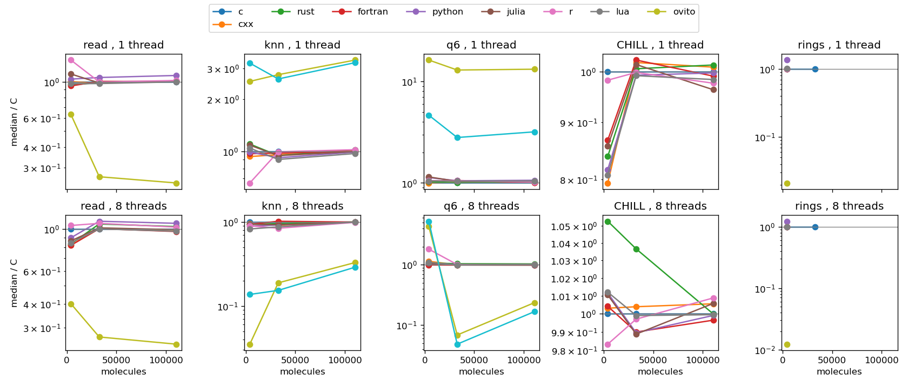

<!-- https://docs.dseams.info/explanation/binding-overhead.md -->

# Binding overhead {#binding-overhead}

Ice Ih at 4096, 32768, and 110592 molecules. GenIce writes a cell
that is not already on disk. The oxygen sites are kept and scaled
from nanometers to angstroms.

The record is an 8-core Intel Xeon. It does not name the host. Each
seams binding is one process for both thread widths. The process sets
`OMP_NUM_THREADS` and `PLUMED_NUM_THREADS` to 1, then to 8, and calls
`seams_set_num_threads` at each width. freud runs inside the Python
process and uses the same widths. The 1-thread and 8-thread OVITO
rows are two processes, started with `OVITO_THREAD_COUNT` set to 1
and to 8. Each cell is the median of 8 repeats after one warmup, in
milliseconds. The median of an even sample is the mean of the two
central values. The number in parentheses is the interquartile range,
quartile 3 minus quartile 1, Hyndman-Fan type 7.

## Handles {#handles}

Read, the mutual 4-neighbour list, and the primitive-ring search
return a handle. The parser and the search run inside libseams. The
C, Fortran, Lua, and ctypes drivers destroy a neighbour or ring
handle inside the timed section. The C++ wrapper destroys that handle
when the owning object leaves scope. On the 110592-molecule cell at 1
thread, Python read is the slowest measured wrapper of read and the
neighbour list: 47.209 ms against the C read median of 43.195 ms, a
ratio of 1.09.

`seams_rings_find` stores the primitive rings through size 6 on the
3.5 angstrom cutoff graph. A 5-ring is marked as a pentagon and a
6-ring as a hexagon. Prism, cage, and stacking labels are written
when `seams_rings_labels` reads the symmetry. The timed calls leave
that symmetry unread, so the prism pass stays out of the measurement.
At 4096 molecules the C median is 991.813 ms at 1 thread and
1561.161 ms at 8 threads. Every binding is repeated at that size. The
C search is also recorded at 32768 molecules, 65237.213 ms at 1
thread and 62041.600 ms at 8 threads. The 110592-molecule ring cells
are empty. A probe of that search had not returned after several
minutes.

At 4096 molecules the Python ctypes ring call is 1344.104 ms at 1
thread, 1.36 times C, and 1909.255 ms at 8 threads, 1.22 times C. The
other languages stay with the C time. Julia and R copy the ring
vertices out of the handle. Fortran also fills a size histogram and
the fraction of atoms on six-membered rings. Those extras sit inside
the C time.

## Per-molecule results {#per-molecule-results}

CHILL writes one label per molecule. The call is original CHILL,
published edges, on the cutoff graph. The timed q6 call writes q6 and
the Lechner-Dellago average q6bar, one double each per molecule, on
the 3.5 angstrom cutoff graph. A null q6bar pointer passed to
`seams_steinhardt` skips that average. The C, C++, and Fortran
drivers, and the ctypes worker, pass both caller-owned buffers. The
C++ wrapper allocates the averaged vector only when the caller asks
for it, and this call asks for it. On the 110592-molecule cell at 1
thread, Lua q6 is 33.288 ms, 1.05 times the C median of 31.822 ms.
The ctypes worker is 33.806 ms on that cell, 1.06 times C.

R times each call with `proc.time` elapsed time. On the calls that
finish in a few milliseconds the R medians fall on whole
milliseconds.

## freud and OVITO {#freud-and-ovito}

freud and OVITO are timed in the same session, on the same oxygen
coordinates. The freud rows are the neighbour query and q6. The OVITO
rows are read, a 4-neighbour finder, q6, and rings.

The seams neighbour list is the mutual 4-nearest graph. Candidates
lie inside 5 angstroms, the 3.5 angstrom cutoff plus 1.5. freud’s
query is the one-way 4-nearest list inside that same shell. OVITO’s
finder is `NearestNeighborFinder` with 4 neighbours. freud’s q6 call
is Steinhardt with l = 6, the averaged parameter, and a neighbour
shell of 3.5 angstroms. OVITO’s Steinhardt modifier uses that cutoff,
maximum degree 6, and the averaged parameters. OVITO’s ring row
creates bonds at 3.5 angstroms and then runs FindRings with a maximum
ring size of 6. That search is a different census from
`seams_rings_find`.

## Eight threads {#eight-threads}

Neighbour lists and CHILL take longer at 8 threads than at 1 thread,
at every size, in every language. q6 on the 4096-molecule cell is
faster at 8 threads: C falls from 0.950 ms to 0.550 ms, and the
languages with a finer clock follow it. R stays at 1 ms on that cell.
On the 32768-molecule cell C q6 rises from 9.065 ms to 278.258 ms,
and on the 110592-molecule cell from 31.822 ms to 294.849 ms.
Primitive rings at 4096 molecules are slower at 8 threads as well.
freud and OVITO neighbour and q6 calls are faster at 8 threads at
every size. The language bindings follow libseams.

*Median time divided by the direct C call. The vertical axis is logarithmic, so a wrapper near 1 and a separate analysis sit on the same axes.*

## Times {#times}

Milliseconds. An empty cell has no sample.

### read {#read}

| binding | 4096 mol, 1 thr | 4096 mol, 8 thr | 32768 mol, 1 thr | 32768 mol, 8 thr | 110592 mol, 1 thr | 110592 mol, 8 thr |
| --- | --- | --- | --- | --- | --- | --- |
| c | 1.473 (0.102) | 1.914 (0.139) | 13.038 (0.407) | 12.593 (0.183) | 43.195 (1.025) | 43.968 (0.419) |
| cxx | 1.477 (0.100) | 1.572 (0.038) | 12.798 (0.531) | 12.691 (0.097) | 43.853 (0.785) | 43.552 (0.319) |
| rust | 1.410 (0.104) | 1.597 (0.063) | 12.887 (0.244) | 13.396 (0.352) | 43.545 (0.605) | 45.336 (0.917) |
| fortran | 1.389 (0.094) | 1.569 (0.026) | 13.117 (0.419) | 12.650 (0.074) | 43.452 (1.531) | 42.667 (0.263) |
| python | 1.529 (0.039) | 1.720 (0.046) | 13.849 (0.257) | 13.853 (0.171) | 47.209 (1.610) | 47.161 (0.339) |
| julia | 1.644 (0.131) | 1.657 (0.057) | 12.826 (0.244) | 12.776 (0.144) | 43.743 (0.802) | 43.656 (1.017) |
| r | 2.000 (0.000) | 2.000 (1.000) | 13.000 (1.000) | 13.500 (1.000) | 44.000 (0.750) | 45.000 (1.500) |
| lua | 1.433 (0.105) | 1.619 (0.077) | 12.719 (0.103) | 12.616 (0.098) | 43.134 (1.148) | 42.844 (0.579) |
| ovito | 0.931 (0.185) | 0.770 (0.322) | 3.430 (0.099) | 3.374 (0.099) | 10.412 (0.095) | 10.792 (0.366) |

### knn {#knn}

| binding | 4096 mol, 1 thr | 4096 mol, 8 thr | 32768 mol, 1 thr | 32768 mol, 8 thr | 110592 mol, 1 thr | 110592 mol, 8 thr |
| --- | --- | --- | --- | --- | --- | --- |
| c | 1.514 (0.079) | 27.743 (10.310) | 11.037 (1.037) | 40.923 (7.282) | 34.649 (1.164) | 87.766 (0.503) |
| cxx | 1.417 (0.074) | 26.379 (5.515) | 10.580 (0.506) | 37.441 (6.457) | 34.709 (1.824) | 87.613 (0.335) |
| rust | 1.671 (0.555) | 26.074 (3.756) | 10.453 (0.475) | 39.154 (3.668) | 35.537 (1.000) | 88.082 (2.917) |
| fortran | 1.471 (0.320) | 26.048 (5.748) | 10.806 (0.314) | 41.825 (7.451) | 34.847 (1.498) | 87.630 (0.269) |
| python | 1.503 (0.168) | 24.730 (7.606) | 10.168 (0.306) | 37.780 (4.181) | 34.388 (0.540) | 87.690 (0.416) |
| julia | 1.646 (0.327) | 26.186 (6.041) | 10.453 (0.338) | 37.962 (5.320) | 34.650 (1.018) | 87.674 (0.354) |
| r | 1.000 (1.000) | 25.000 (4.000) | 11.000 (0.000) | 34.500 (5.750) | 35.500 (1.000) | 87.000 (0.250) |
| lua | 1.584 (0.310) | 22.932 (6.993) | 9.941 (0.256) | 35.865 (8.944) | 33.749 (0.511) | 87.746 (0.221) |
| freud | 3.816 (0.118) | 0.971 (0.075) | 30.398 (0.793) | 7.711 (0.173) | 115.737 (2.468) | 28.924 (0.704) |
| ovito | 4.855 (0.130) | 3.803 (0.118) | 28.731 (0.191) | 6.271 (2.759) | 111.893 (0.967) | 25.452 (0.290) |

### q6 {#q6}

| binding | 4096 mol, 1 thr | 4096 mol, 8 thr | 32768 mol, 1 thr | 32768 mol, 8 thr | 110592 mol, 1 thr | 110592 mol, 8 thr |
| --- | --- | --- | --- | --- | --- | --- |
| c | 0.950 (0.065) | 0.550 (0.038) | 9.065 (0.103) | 278.258 (5.256) | 31.822 (0.170) | 294.849 (4.382) |
| cxx | 0.950 (0.038) | 0.630 (0.014) | 9.198 (0.075) | 277.243 (7.035) | 32.071 (0.236) | 293.159 (4.447) |
| rust | 0.977 (0.036) | 0.590 (0.089) | 9.093 (0.117) | 290.282 (8.931) | 32.849 (0.383) | 305.443 (9.056) |
| fortran | 0.993 (0.050) | 0.548 (0.018) | 9.590 (0.142) | 275.684 (3.985) | 32.046 (0.311) | 292.669 (5.437) |
| python | 1.074 (0.038) | 0.591 (0.012) | 9.518 (0.126) | 280.564 (4.839) | 33.806 (0.391) | 292.919 (4.287) |
| julia | 1.089 (0.032) | 0.586 (0.039) | 9.403 (0.242) | 276.384 (5.361) | 32.778 (0.667) | 290.929 (3.464) |
| r | 1.000 (0.000) | 1.000 (0.000) | 9.500 (1.000) | 281.000 (9.250) | 32.500 (1.000) | 298.000 (7.250) |
| lua | 0.997 (0.024) | 0.605 (0.016) | 9.421 (0.096) | 276.478 (8.887) | 33.288 (0.280) | 299.717 (3.706) |
| freud | 15.445 (0.538) | 2.370 (0.110) | 117.509 (0.663) | 19.127 (0.680) | 420.061 (3.630) | 69.442 (2.957) |
| ovito | 4.420 (0.170) | 2.902 (0.119) | 25.406 (0.153) | 13.486 (4.197) | 101.413 (0.776) | 49.343 (20.923) |

### CHILL {#chill}

| binding | 4096 mol, 1 thr | 4096 mol, 8 thr | 32768 mol, 1 thr | 32768 mol, 8 thr | 110592 mol, 1 thr | 110592 mol, 8 thr |
| --- | --- | --- | --- | --- | --- | --- |
| c | 2.545 (0.599) | 215.612 (13.410) | 15.028 (0.144) | 281.844 (8.804) | 50.706 (0.660) | 307.791 (3.955) |
| cxx | 2.022 (0.175) | 216.275 (12.959) | 15.311 (0.533) | 282.941 (4.131) | 51.169 (0.729) | 309.498 (3.983) |
| rust | 2.136 (0.631) | 226.970 (8.981) | 15.115 (0.347) | 292.174 (9.213) | 51.398 (0.779) | 307.757 (1.419) |
| fortran | 2.209 (0.468) | 216.502 (11.087) | 15.389 (0.335) | 278.995 (5.726) | 50.230 (0.397) | 306.692 (3.310) |
| python | 2.078 (0.448) | 218.109 (12.232) | 14.914 (0.396) | 278.877 (9.074) | 50.560 (0.435) | 307.498 (0.622) |
| julia | 2.182 (0.983) | 217.869 (11.820) | 15.247 (0.396) | 278.677 (2.682) | 48.838 (0.491) | 309.555 (3.159) |
| r | 2.500 (1.000) | 212.000 (13.750) | 15.000 (1.000) | 281.000 (4.250) | 49.500 (1.250) | 310.500 (4.000) |
| lua | 2.055 (0.272) | 218.213 (6.988) | 14.900 (0.170) | 281.558 (4.855) | 49.876 (0.791) | 307.628 (0.315) |

### rings {#rings}

| binding | 4096 mol, 1 thr | 4096 mol, 8 thr | 32768 mol, 1 thr | 32768 mol, 8 thr | 110592 mol, 1 thr | 110592 mol, 8 thr |
| --- | --- | --- | --- | --- | --- | --- |
| c | 991.813 (24.299) | 1561.161 (15.766) | 65237.213 (2485.686) | 62041.600 (202.918) |  |  |
| cxx | 993.822 (2.624) | 1559.290 (5.610) |  |  |  |  |
| rust | 996.532 (5.895) | 1558.758 (17.700) |  |  |  |  |
| fortran | 989.092 (2.912) | 1554.381 (15.306) |  |  |  |  |
| python | 1344.104 (4.591) | 1909.255 (9.019) |  |  |  |  |
| julia | 992.607 (5.326) | 1553.860 (10.599) |  |  |  |  |
| r | 994.500 (4.750) | 1549.500 (3.750) |  |  |  |  |
| lua | 1002.424 (18.117) | 1552.125 (5.559) |  |  |  |  |
| ovito | 20.977 (0.993) | 19.223 (0.599) |  |  |  |  |
