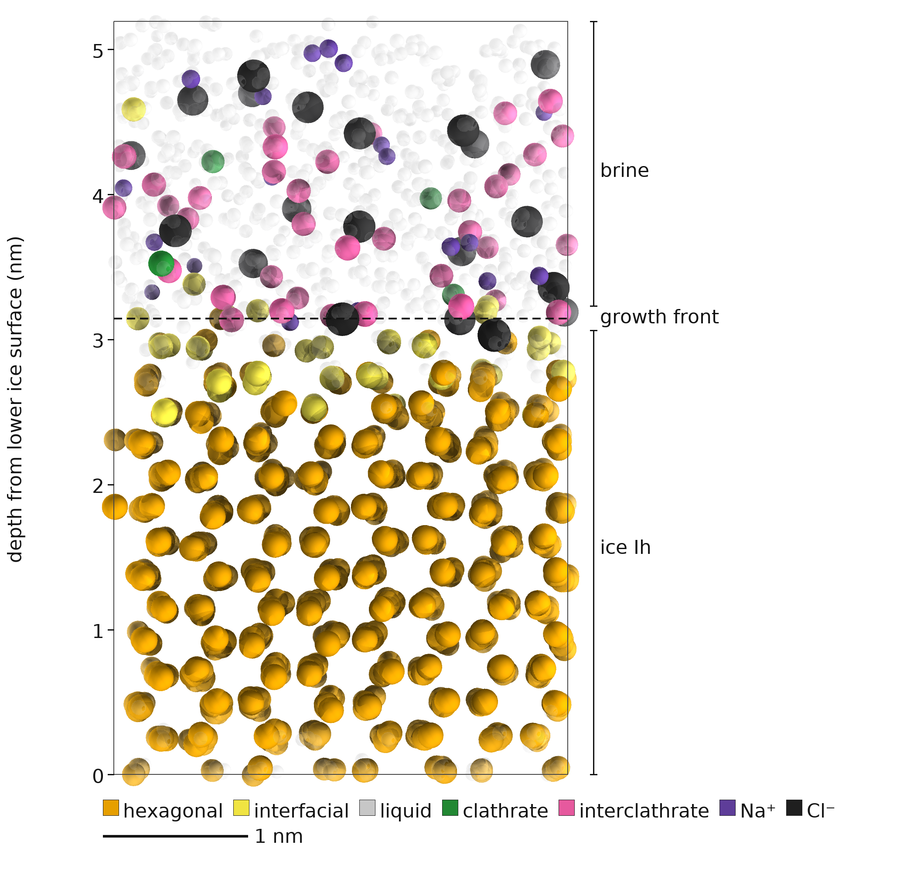

<!-- https://docs.dseams.info/science/brine.md -->

# Brine freezing front {#brine-freezing-front}

The
[d-SEAMS/brine-front-230K](https://huggingface.co/datasets/d-SEAMS/brine-front-230K)
dataset provides the initial and final frames for a 20-pair loading.
Download `T230_m20_r0_t0.xyz` and `T230_m20_r0_tend.xyz` before
running the analysis.

Each file stores a CHILL+ name on every oxygen. The engine is run again
on the oxygen coordinates. All 1496 oxygens match the stored names at
both times. Ice is hexagonal or cubic. Sodium is the ion, water is
type 1, the axis is z, and the bin count is 20. The rejection
coefficient is the bulk-ice molality divided by the bulk-liquid molality.

```text
brine t0 hexagonal 733 water 619 interfacial 91 cubic 1 agree 1496
brine t0 thickness 25.5618 k 0.0
brine tend hexagonal 741 water 621 interfacial 89 cubic 0 agree 1496
brine tend thickness 25.3740 k 0.0
```

```python
    box, rows = read_xyz(path)
    type_of = {"O": 1, "H": 2, "Na": 3, "Cl": 4}
    xyz = []
    types = []
    for species, x, y, z, _chill in rows:
        xyz.extend((x, y, z))
        types.append(type_of[species])
    count = len(rows)
    points = (ctypes.c_double * len(xyz))(*xyz)
    box9 = (ctypes.c_double * 9)(box[0], box[1], box[2], box[3], box[4], box[5], 0, 0, 0)
    kinds = (ctypes.c_int * count)(*types)
    system = lib.seams_system_create()
    if lib.seams_system_set_frame(system, points, count, box9, kinds, None) != 0:
        raise SystemExit(lib.seams_last_error())
    labels = (ctypes.c_int * count)()
    counts = (ctypes.c_int * 9)()
    if lib.seams_chill_plus(system, 3.5, 1, 0, 0, labels, counts) != 0:
        raise SystemExit(lib.seams_last_error())
    oxygen = [i for i, row in enumerate(rows) if row[0] == "O"]
    agree = sum(labels[i] == NAMES.index(rows[i][4]) for i in oxygen)
    histogram = {name: 0 for name in NAMES}
    for index in oxygen:
        histogram[NAMES[labels[index]]] += 1
    ice = (ctypes.c_int * count)(
        *[1 if rows[i][0] == "O" and labels[i] in (0, 1) else 0 for i in range(count)]
    )
    front = ctypes.c_void_p()
    # water type 1, sodium type 3, 20 bins, axis z.
    if lib.seams_brine_analyse(system, ice, count, 1, 3, 20, 2, ctypes.byref(front)) != 0:
        raise SystemExit(lib.seams_last_error())
    enter = ctypes.c_double()
    leave = ctypes.c_double()
    thick = ctypes.c_double()
    found = ctypes.c_int()
    if lib.seams_brine_fronts(
        front, ctypes.byref(enter), ctypes.byref(leave), ctypes.byref(thick), ctypes.byref(found)
    ) != 0:
        raise SystemExit("fronts")
    c_ice = ctypes.c_double()
    c_liquid = ctypes.c_double()
    coeff = ctypes.c_double()
    defined = ctypes.c_int()
    if lib.seams_brine_rejection(
        front, ctypes.byref(c_ice), ctypes.byref(c_liquid), ctypes.byref(coeff), ctypes.byref(defined)
    ) != 0:
        raise SystemExit("rejection")
    lib.seams_brine_destroy(front)
    lib.seams_system_destroy(system)
    return {
        "agree": agree,
        "oxygen": len(oxygen),
        "histogram": histogram,
        "found": int(found.value),
        "thickness": float(thick.value),
        "c_ice": float(c_ice.value),
        "k": float(coeff.value),
        "defined": int(defined.value),
    }
```

```c
  double *xyz = NULL;
  int *types = NULL;
  int n = 0;
  double box9[9];
  char(*chill)[16] = NULL;
  /* 4608 is the largest frame in this tutorial. Grow if the header says more. */
  FILE *probe = fopen(path, "r");
  char first[64];
  if (probe == NULL || fgets(first, sizeof first, probe) == NULL) {
    die(path);
  }
  fclose(probe);
  int declared = atoi(first);
  chill = calloc((size_t)declared, 16);
  if (read_xyz(path, &xyz, &types, chill, &n, box9) != 0) {
    die(path);
  }
  seams_system *sys = seams_system_create();
  if (seams_system_set_frame(sys, xyz, n, box9, types, NULL) != SEAMS_OK) {
    die("set_frame");
  }
  int *labels = calloc((size_t)n, sizeof(int));
  int counts[9] = {0};
  if (seams_chill_plus(sys, 3.5, 1, 0, 0, labels, counts) != SEAMS_OK) {
    die("chill+");
  }
  int agree = 0;
  int oxygen = 0;
  int histogram[9] = {0};
  for (int i = 0; i < n; i++) {
    if (types[i] != 1) {
      continue;
    }
    oxygen += 1;
    histogram[labels[i]] += 1;
    if (strcmp(chill[i], LABELS[labels[i]]) == 0) {
      agree += 1;
    }
  }
  int *ice = calloc((size_t)n, sizeof(int));
  for (int i = 0; i < n; i++) {
    ice[i] = types[i] == 1 && (labels[i] == 0 || labels[i] == 1);
  }
  seams_brine *front = NULL;
  if (seams_brine_analyse(sys, ice, (size_t)n, 1, 3, 20, 2, &front) != SEAMS_OK) {
    die("brine");
  }
  double thickness = 0;
  int found = 0;
  double c_ice = 0;
  double coeff = 0;
  int defined = 0;
  if (seams_brine_fronts(front, NULL, NULL, &thickness, &found) != SEAMS_OK) {
    die("fronts");
  }
  if (seams_brine_rejection(front, &c_ice, NULL, &coeff, &defined) != SEAMS_OK) {
    die("rejection");
  }
  printf("brine %s hexagonal %d water %d interfacial %d cubic %d agree %d\n", tag,
         histogram[1], histogram[2], histogram[3], histogram[0], agree);
  printf("brine %s thickness %.4f k %.1f found %d defined %d\n", tag, thickness, coeff, found,
         defined);
  seams_brine_destroy(front);
  seams_system_destroy(sys);
  free(xyz);
  free(types);
  free(labels);
  free(ice);
  free(chill);
  (void)oxygen;
}
```



*The 5 ns frame. Hydrogens are omitted. CHILL+ reports 741 hexagonal,
621 liquid, 89 interfacial, 41 interfacial clathrate, 4 clathrate,
and no cubic molecules. Sodium and chloride remain in the liquid.*

## What this tells you {#what-this-tells-you}

Over 5 ns at 230 K the hexagonal count moves from 733 to 741 and the
ice run stays near 25.5 angstrom. The bulk ice holds no sodium, so the
rejection coefficient is 0: the salt stays in the liquid. The printed
line names hexagonal, liquid, interfacial, and cubic. The other
oxygens are the 41 interfacial clathrate and 4 clathrate molecules in
the figure, and 741 + 621 + 89 + 41 + 4 is the 1496 that agree. The
stored labels and a fresh CHILL+ call name every oxygen the same way.
