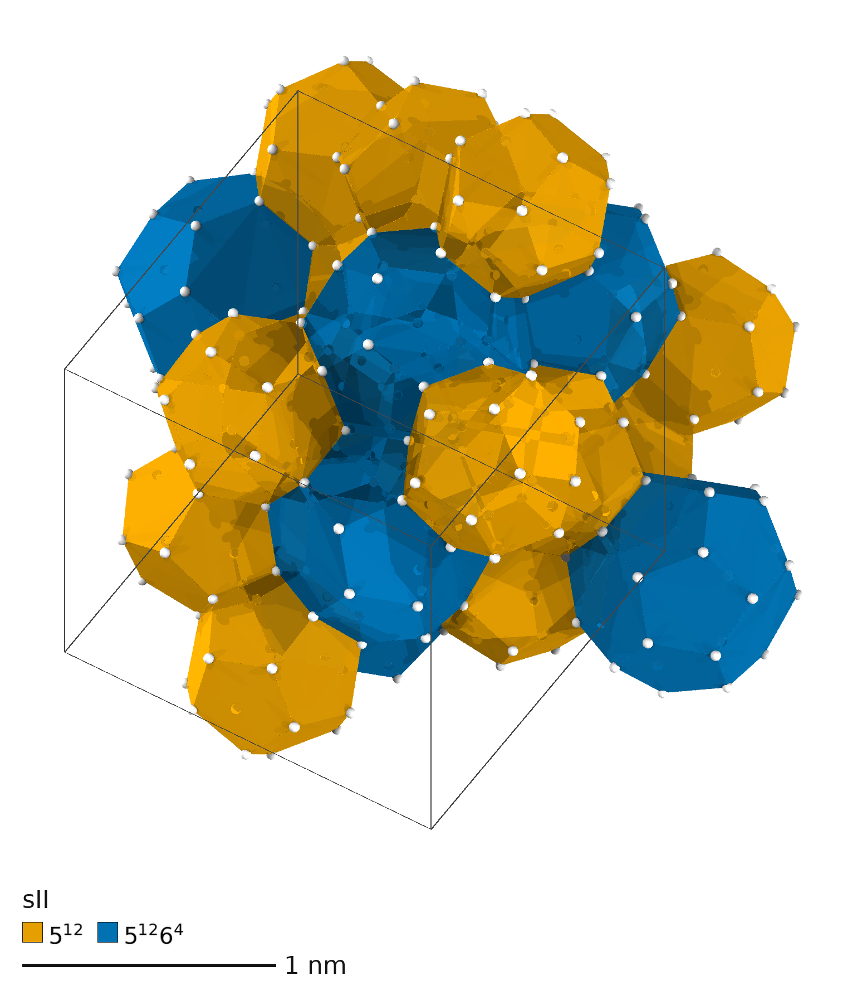
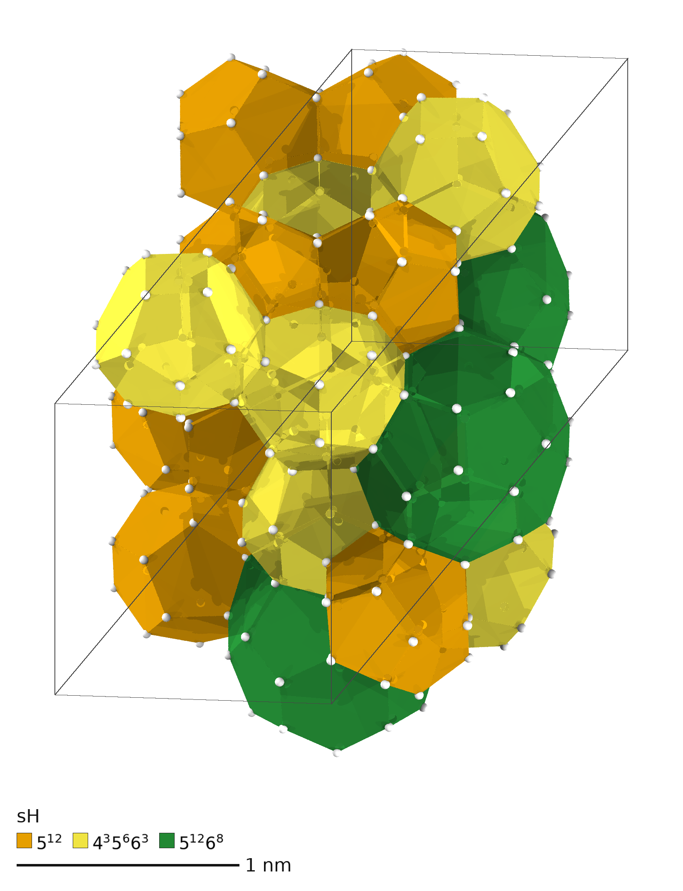

<!-- https://docs.dseams.info/science/cages.md -->

# sII and sH hydrate cages {#sii-and-sh-hydrate-cages}

`input/traj/genice_sII.lammpstrj` and `input/traj/genice_sH.lammpstrj`
are guest-free GenIce hosts, 136 waters each. sH keeps the triclinic
tilt. Closed cages are counted with `seams_cages_signature` at 3.5
angstrom on the cutoff graph. The signatures are `512` for
$5^{12}$, `51264` for $5^{12}6^{4}$, `sh` for
$4^{3}5^{6}6^{3}$, and `51268` for $5^{12}6^{8}$.

```text
cages sII 512 16
cages sII 51264 8
cages sH 512 12
cages sH sh 8
cages sH 51268 4
```

```python
    system = lib.seams_system_create()
    if lib.seams_system_read(system, str(path).encode(), 1, -1) != 0:
        raise SystemExit(lib.seams_last_error())
    cages = ctypes.c_size_t()
    atoms = ctypes.c_size_t()
    if lib.seams_cages_signature(
        system, 3.5, 0, 0, spec.encode(), ctypes.byref(cages), ctypes.byref(atoms)
    ) != 0:
        raise SystemExit(lib.seams_last_error())
    lib.seams_system_destroy(system)
    return int(cages.value)
```

```c
  seams_system *sys = seams_system_create();
  if (seams_system_read(sys, path, 1, -1) != SEAMS_OK) {
    die(path);
  }
  size_t cages = 0;
  size_t atoms = 0;
  if (seams_cages_signature(sys, 3.5, 0, 0, spec, &cages, &atoms) != SEAMS_OK) {
    die(spec);
  }
  seams_system_destroy(sys);
  return (int)cages;
}

static int cmd_cages(void) {
  printf("cages sII 512 %d\n", cages_of("input/traj/genice_sII.lammpstrj", "512"));
  printf("cages sII 51264 %d\n", cages_of("input/traj/genice_sII.lammpstrj", "51264"));
  printf("cages sH 512 %d\n", cages_of("input/traj/genice_sH.lammpstrj", "512"));
  printf("cages sH sh %d\n", cages_of("input/traj/genice_sH.lammpstrj", "sh"));
  printf("cages sH 51268 %d\n", cages_of("input/traj/genice_sH.lammpstrj", "51268"));
  return 0;
}
```



*sII. Orange is $5^{12}$ and blue is $5^{12}6^{4}$, the hexagonal and cubic colors. The legend is titled sII and the frame includes every cage.*



*sH. Orange is $5^{12}$, yellow is $4^{3}5^{6}6^{3}$, and green is $5^{12}6^{8}$. Each face is the ring placed on the images nearest the cage center. A face is omitted when an edge reaches 3.5 angstrom or the planarity residual exceeds 0.35 angstrom. The legend is titled sH and the frame includes every cage.*

## What this tells you {#what-this-tells-you}

One sII cell holds 16 pentagonal dodecahedra and 8 of $5^{12}6^{4}$.
Four sH formula units hold 12 of $5^{12}$, 8 of
$4^{3}5^{6}6^{3}$, and 4 of $5^{12}6^{8}$. Those are the
cage numbers that separate the two hydrates. A count that dropped the
sheared sH edges would miss the cages whose bonds cross the xy tilt.
