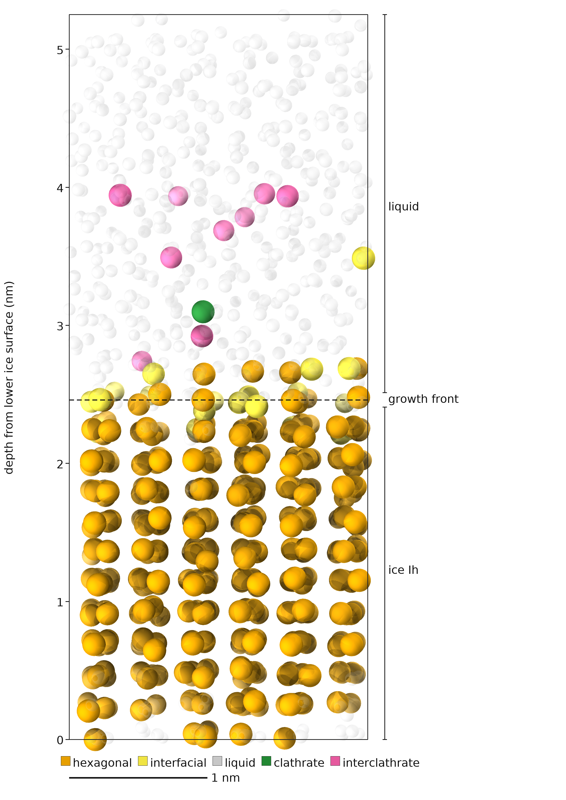
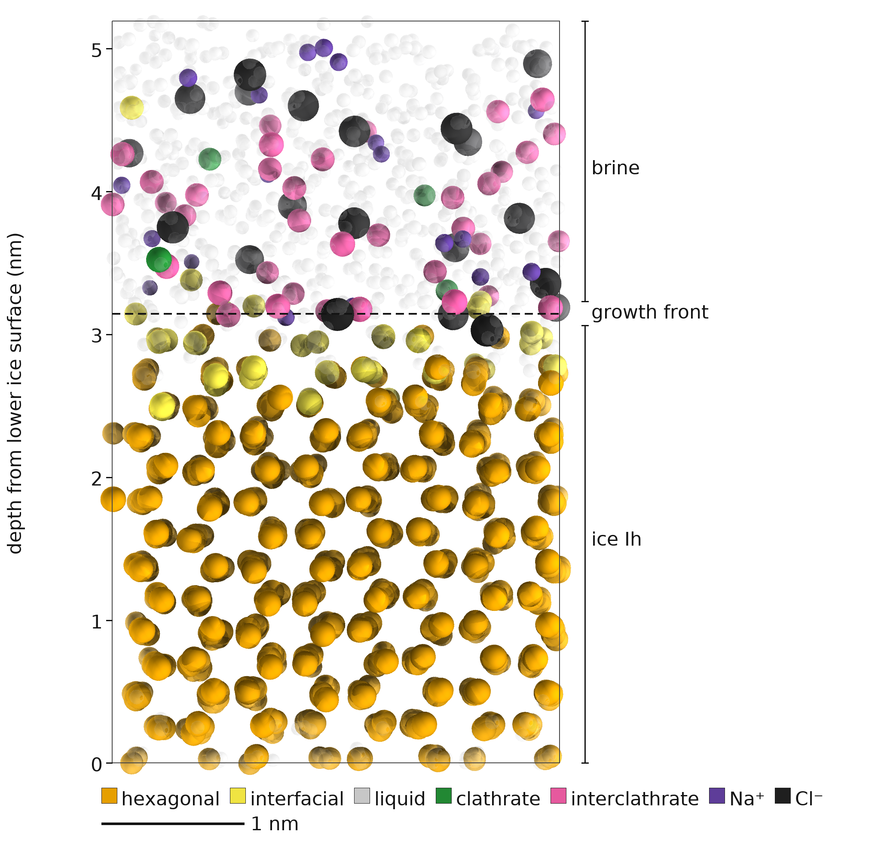

<!-- https://docs.dseams.info/science/gallery.md -->

# Science figures {#science-figures}

These four molecular views accompany the science tutorials. Each caption
reports the molecular census that the science
tutorials check.

*Interface. 352 hexagonal, 434 liquid, 49 interfacial, 3 clathrate, 25 interfacial clathrate, and 1 cubic.*

*Brine front. 741 hexagonal, 621 liquid, 89 interfacial, 4 clathrate, 41 interfacial clathrate, and 0 cubic.*

*sH. 136 waters, 12 of $5^{12}$, 8 of $4^{3}5^{6}6^{3}$, and 4 of $5^{12}6^{8}$.*

*sII. 136 waters, 16 of $5^{12}$, and 8 of $5^{12}6^{4}$.*
