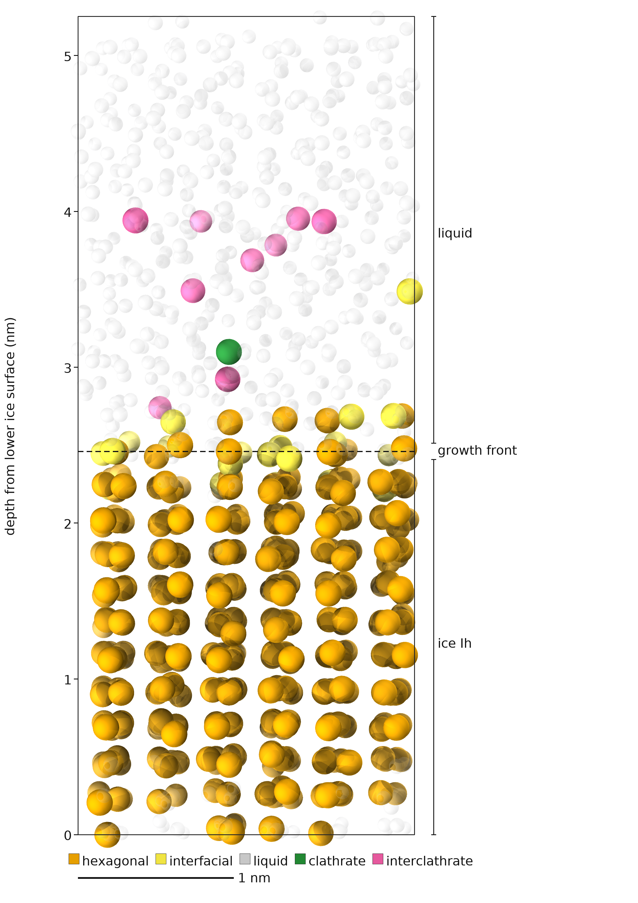

<!-- https://docs.dseams.info/science/interface.md -->

# Ice/liquid interface and nucleation {#ice-liquid-interface-and-nucleation}

The interface dump is `input/traj/interface_f0.lammpstrj`, 864 waters
in a cell 23 by 22 by 53 angstrom. The nucleus is frame 1 of the mW
trajectory released with the paper (`input/traj/nucleation_f1.lammpstrj`,
4096 atoms, timestep 15677000). Both are labeled with published CHILL+
at 3.5 angstrom on the cutoff graph.

Layer cubicity is the cubic share of the basal layers. On the slab the
stacking axis is z, the long edge. On the nucleus it is the box axis
whose crystal atoms have the strongest density wave in that period
window. The molecular view numbers the basal layers and shows liquid
with reduced opacity.

Python and C print the same census:

```text
interface hexagonal 352 water 434 interfacial 49 cubic 1
interface layers HHHHHHHHC cubicity 0.111111
nucleus cubic 47 hexagonal 62 water 3589 interfacial 240
nucleus axis x layers CHHHCHHHHHHHHH cubicity 0.142857
```

```python
    """Basal repeat, the same scan as science_render.layer_period."""
    best_score = -1.0
    best = 3.6
    centered = projection - float(np.mean(projection))
    for period in np.linspace(3.30, 4.05, 16):
        wave = np.exp(1j * (2.0 * math.pi / float(period)) * centered)
        score = float(np.abs(np.mean(wave)))
        if score > best_score:
            best_score = score
            best = float(period)
    return best

def layer_score(projection: np.ndarray, period: float) -> float:
    centered = projection - float(np.mean(projection))
    wave = np.exp(1j * (2.0 * math.pi / period) * centered)
    return float(np.abs(np.mean(wave)))

def layer_kinds(pos, chill, axis) -> list[int]:
    """Ih (1) or Ic (0) for each basal layer. Same rule as science_render."""
    chosen = np.flatnonzero(np.isin(chill, [0, 1]))
    axis = np.asarray(axis, dtype=float)
    axis = axis / np.linalg.norm(axis)
    projection = pos[chosen] @ axis
    kinds = chill[chosen]
    bins = np.floor((projection - projection.min()) / layer_period(projection)).astype(int)
    letters = []
    for index in range(int(bins.max()) + 1):
        selected = kinds[bins == index]
        hexagonal = int(np.sum(selected == 1))
        cubic = int(np.sum(selected == 0))
        if hexagonal + cubic == 0:
            continue
        letters.append(1 if hexagonal >= cubic else 0)
    return letters

def cubicity(kinds: list[int]) -> float:
    return sum(1 for kind in kinds if kind == 0) / float(len(kinds))
```

```c
  double mean = 0;
  for (int i = 0; i < n; i++) {
    mean += projection[i];
  }
  mean /= (double)n;
  double best_score = -1;
  double best = 3.6;
  for (int step = 0; step < 16; step++) {
    double period = 3.30 + (4.05 - 3.30) * (double)step / 15.0;
    double re = 0;
    double im = 0;
    for (int i = 0; i < n; i++) {
      double angle = (2.0 * 3.14159265358979323846 / period) * (projection[i] - mean);
      re += cos(angle);
      im += sin(angle);
    }
    double score = hypot(re, im) / (double)n;
    if (score > best_score) {
      best_score = score;
      best = period;
    }
  }
  return best;
}

static double layer_score(const double *projection, int n, double period) {
  double mean = 0;
  for (int i = 0; i < n; i++) {
    mean += projection[i];
  }
  mean /= (double)n;
  double re = 0;
  double im = 0;
  for (int i = 0; i < n; i++) {
    double angle = (2.0 * 3.14159265358979323846 / period) * (projection[i] - mean);
    re += cos(angle);
    im += sin(angle);
  }
  return hypot(re, im) / (double)n;
}

/* Returns the stacking string. axis is 0, 1, or 2. */
static void layer_string(const double *xyz, const int *chill, int n, int axis, char *out) {
  int crystal = 0;
  for (int i = 0; i < n; i++) {
    if (chill[i] == 0 || chill[i] == 1) {
      crystal += 1;
    }
  }
  double *projection = malloc((size_t)crystal * sizeof(double));
  int *kinds = malloc((size_t)crystal * sizeof(int));
  int cursor = 0;
  double lo = 0;
  for (int i = 0; i < n; i++) {
    if (chill[i] != 0 && chill[i] != 1) {
      continue;
    }
    projection[cursor] = xyz[3 * i + axis];
    kinds[cursor] = chill[i];
    if (cursor == 0 || projection[cursor] < lo) {
      lo = projection[cursor];
    }
    cursor += 1;
  }
  double period = layer_period(projection, crystal);
  int bins_max = 0;
  int *bin = malloc((size_t)crystal * sizeof(int));
  for (int i = 0; i < crystal; i++) {
    bin[i] = (int)floor((projection[i] - lo) / period);
    if (bin[i] > bins_max) {
      bins_max = bin[i];
    }
  }
  int length = 0;
  for (int index = 0; index <= bins_max; index++) {
    int hexagonal = 0;
    int cubic = 0;
    for (int i = 0; i < crystal; i++) {
      if (bin[i] != index) {
        continue;
      }
      if (kinds[i] == 1) {
        hexagonal += 1;
      } else {
        cubic += 1;
      }
    }
    if (hexagonal + cubic == 0) {
      continue;
    }
    out[length++] = hexagonal >= cubic ? 'H' : 'C';
  }
  out[length] = '\0';
  free(projection);
  free(kinds);
  free(bin);
}

static int strongest_axis(const double *xyz, const int *chill, int n) {
  int crystal = 0;
  for (int i = 0; i < n; i++) {
    if (chill[i] == 0 || chill[i] == 1) {
      crystal += 1;
    }
  }
  double *projection = malloc((size_t)crystal * sizeof(double));
  int best = 0;
  double best_score = -1;
  for (int axis = 0; axis < 3; axis++) {
    int cursor = 0;
    for (int i = 0; i < n; i++) {
      if (chill[i] == 0 || chill[i] == 1) {
        projection[cursor++] = xyz[3 * i + axis];
      }
    }
    double period = layer_period(projection, crystal);
    double score = layer_score(projection, crystal, period);
    if (score > best_score) {
      best_score = score;
      best = axis;
    }
  }
  free(projection);
  return best;
}
```



*This is the primary prism face $(10\bar{1}0)$. The basal planes stand perpendicular to the interface, so the bilayers are vertical, and growth runs along z. The orthographic camera looks straight down x. The vertical axis reads `depth from lower ice surface (nm)`, the same axis as the brine figure, and the cell origin is the lowest hexagonal oxygen. Brackets with end ticks mark the liquid and the ice, with a gap between them. A dashed line across the cell is the growth front. The 1 nm bar is the on-screen length of 10 angstrom along the cell edge. The picture is clipped to one sphere radius outside the cell on every side. Liquid is radius 0.50 at 18 percent opacity. CHILL+ on the whole cell is 49 interfacial, 25 interfacial clathrate, 3 clathrate and 1 cubic. The picture keeps those colors only within 1.5 nm of the growth front. Farther from the front, everything except the hexagonal crystal is drawn as liquid. The classifier itself is unchanged. The legend is one row, in the same order as the brine figure.*

## What this tells you {#what-this-tells-you}

The slab is a hexagonal ice block against liquid. 352 molecules are
hexagonal, 434 are liquid, and 49 are the interfacial shell. One
molecule is cubic. The caption’s 25 interfacial clathrate and 3
clathrate molecules are the rest of the 864. Along z the old floor
bins count the cubic molecule as its own layer and the cubicity of
those nine bins is 1/9. The figure does not number it. The numbered
index is the basal stack: six bilayers of hexagonal ice. The nucleus
in the first saved frame is mixed: 47 cubic and 62 hexagonal molecules
in a liquid of 3589, with 240 interfacial. Molecule cubicity is
47/109. Along x, two of the fourteen layers are cubic-majority, so
the layer cubicity is 2/14. That mixed stacking is the quantity the
layer panel of the paper figure is drawn to show.
