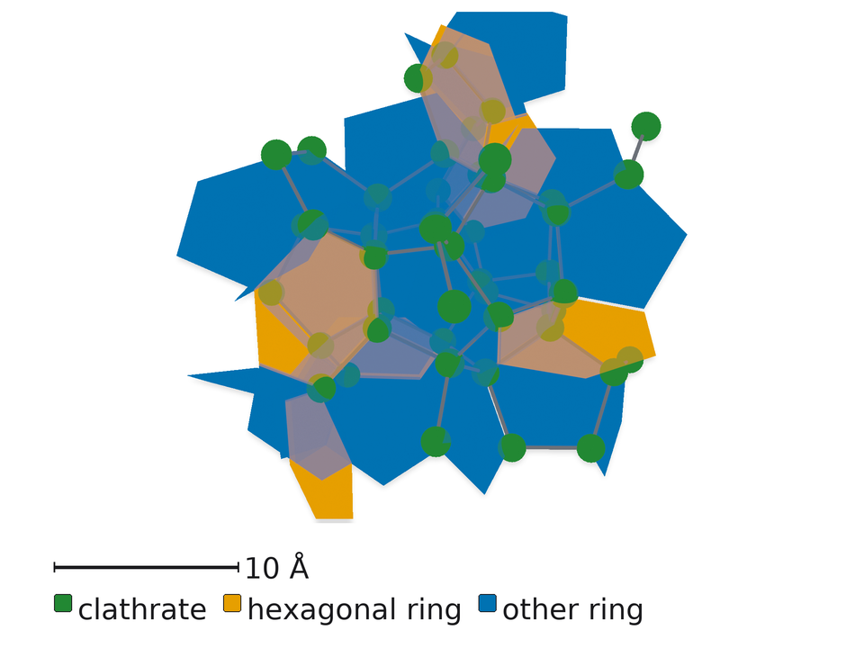

<!-- https://docs.dseams.info/user/tutorials/rings.md -->

# Primitive rings {#primitive-rings}

The recording counts primitive rings on the mixed TIP4P frame, 511
rings, then the 256 six-rings of ice Ih.

A primitive ring is a cycle that passes Franzblau’s shortest-path test.
For every pair of vertices on the cycle, a shortest path between them
lies on the cycle. The worked example is on
[Primitive rings and the full graph](../../explanation/primitive-rings.md).

`seams rings` counts those rings on the cutoff neighbour list. The
default cutoff is 3.5 Å. The default deepest ring is 6.

## The mixed frame {#the-mixed-frame}

`input/traj/exampleTraj.lammpstrj` has 750 atoms. Type 2 is the 250
oxygens. Type 1 is hydrogen.

```bash
seams rings input/traj/exampleTraj.lammpstrj --type 2 --cutoff 3.5
```

```default
nop 250 rings 511
3 37
4 273
5 34
6 167
```

The histogram is 37 three-rings, 273 four-rings, 34 five-rings, and 167
six-rings. `--max-ring 8` prints the same histogram.

## Ice Ih {#ice-ih}

```bash
seams rings input/traj/ice1h.lammpstrj --type 1 --cutoff 3.5
```

```default
nop 128 rings 256
6 256
```

The default census stops at six-membered rings. This cell has 256 of
them. A deeper `--max-ring` also reports larger rings. With
`--max-ring 12` the extra lines are `8 352`, `10 512`, and `12 512`.



*Five-rings and six-rings of the sI host, drawn on the oxygen cell.*
